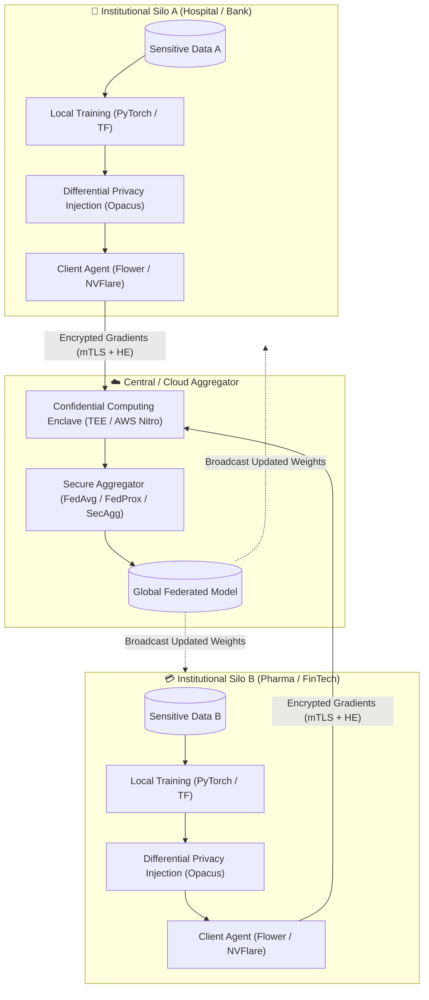

  

<h1 align="center">🌐 Awesome Federated Learning Infrastructure</h1>

  <strong>🔒 A curated directory of enterprise SaaS platforms, confidential computing clean rooms, and open-source frameworks for privacy-preserving distributed machine learning.</strong>

  
  
  
  
  
  
  

  <a href="#-sector-overview--market-dynamics">📊 Sector Overview</a> •
  <a href="#-saashosted-platforms">🏢 SaaS &amp; Hosted Platforms</a> •
  <a href="#-open-source-github-projects">💻 Open-Source Frameworks</a> •
  <a href="#-privacy-enhancing-technologies-comparison">🛡️ PETs Matrix</a> •
  <a href="#-recommended-enterprise-architecture">🏗️ Architecture</a> •
  <a href="#-how-to-contribute">🤝 Contributing</a> •
  <a href="#-support">💖 Support</a> •
  <a href="#-star-history">⭐ Star History</a> •
  <a href="#-disclaimer">⚠️ Disclaimer</a>

---

## 🧠 Overview &amp; Key Concepts

**Federated Learning (FL)** enables organizations and edge devices to collaboratively train machine learning models without centralizing raw data. Local training nodes compute model weight updates (gradients) behind internal firewalls and transmit only encrypted parameters to an aggregator, which fuses them into a global model.

This ecosystem repository curates **production-grade SaaS clean rooms**, **cloud-native MLOps schedulers**, and **open-source cross-silo/cross-device frameworks** supporting Privacy-Enhancing Technologies (PETs) including:
- 🔐 **Secure Aggregation (SecAgg)**: Cryptographic masking ensuring aggregators learn only the summed weights, never individual client gradients.
- 🎯 **Differential Privacy (DP)**: Calibrated noise injection bounding information leakage from individual training samples.
- 🧩 **Homomorphic Encryption (HE / CKKS / BFV)**: Mathematical operations performed directly on ciphertext.
- 🛡️ **Trusted Execution Environments (TEEs / Confidential Computing)**: Hardware-isolated enclaves (AMD SEV, Intel SGX/TDX, AWS Nitro Enclaves) preventing even cloud hypervisors from inspecting running workloads.

---

## 📊 Sector Overview &amp; Market Dynamics

The global **Federated Learning and Confidential AI Infrastructure market** is estimated at **$167M – $178M in 2026** (pure-play software platforms), expanding at a **14.4% CAGR to $297M – $315M by 2030**, and projected to surpass **$5.7B+** when factoring in specialized edge AI hardware and enterprise data clean rooms.

The industry is currently **moderately fragmented** rather than concentrated into a single winner-take-all monopoly:
- 🏥 **Vertical Specialization**: Healthcare/biopharma consortia require HIPAA/FDA-grade auditability (led by players like Owkin, Rhino Health, and Apheris), whereas financial institutions focus on anti-money laundering (AML) and credit fraud detection across siloed commercial banks (Sherpa.ai, Decentriq).
- ⚙️ **Hybrid Infrastructure**: Enterprises deploy a dual stack combining open-source orchestrators (Flower, FATE, PySyft) with hardware-enforced cloud clean rooms (AWS Nitro, Azure Confidential Computing), preventing vertical vendor lock-in.

---

## 🏢 SaaS/Hosted Platforms

All platforms below are evaluated by organizational scale, core privacy architecture, verified starting tier pricing, and explicit free trial/sandbox allocations.

> 📊 Sorted descending by **Company Scale (Valuation / Total Funding / Revenue)**:

| 🏢 Platform / Company | 💰 Company Size (Valuation / Revenue) | 🎯 Primary Focus &amp; Architecture | 💵 Specific Starting Tier Price | 🎁 Free Tier / Trial Limits |
| :--- | :--- | :--- | :--- | :--- |
| **[Owkin](https://www.owkin.com/)** | **$1.0B+ Valuation** *(Unicorn; $304M+ raised; Series B led by Sanofi; ~$25M-$50M ARR)* | 🧬 Federated biopharma discovery, clinical trial optimization, and oncology predictive biomarker discovery across academic medical networks. | **$35,000 / year** *(Starting pilot research node license under enterprise agreement)* | **14-day guided proof-of-concept trial** *(Limited to 1 simulated data node, synthetic biomedical dataset, and 1 standard biomarker discovery pipeline)* |
| **[Flower Labs](https://flower.ai/)** *(Flower SuperGrid)* | **~$100M Valuation** *($24M+ raised; $20M Series A led by Felicis &amp; YC; ~$3M ARR)* | 🌸 Enterprise collaborative AI orchestration, cross-cloud SuperGrid federation, and multi-cloud federated LLM fine-tuning. | **$49 / month** *(Pro Orchestrator starting tier; Enterprise from $1,500/mo)* | **Free forever tier** *(Includes up to 2 federated nodes, 1 concurrent simulation run, and community Slack support)* |
| **[TensorOpera AI](https://tensoropera.ai/)** *(FedML)* | **~$75M Valuation** *($11.5M+ raised led by Camford Capital; ~$4M ARR)* | ⚡ Scalable cross-cloud distributed training, federated MLOps, cross-cloud GPU scheduling, and serverless LLM edge deployment. | **$199 / month** *(Advanced Orchestrator plan; pay-as-you-go serverless models from $0.10/1M tokens)* | **Free forever plan** *(Includes 1 active collaborative project, 2 edge client devices, community MLOps scheduler, and BYO compute)* |
| **[Sherpa.ai](https://sherpa.ai/)** | **~$65M Valuation** *($34M+ raised; $18M growth round backed by Forgepoint Capital &amp; Mundi)* | 🏦 Production cross-silo FL for tier-1 banking fraud detection, multi-bank credit risk scoring, and rare-disease genomics with NIH. | **$2,500 / month** *($30,000 / year starting enterprise gateway subscription)* | **30-day sandbox pilot trial** *(Limited to 2 simulated institutional data silos, 5 training runs, and synthetic credit/fraud benchmark datasets)* |
| **[Rhino Health](https://www.rhinohealth.com/)** | **~$60M Valuation** *($30M+ raised; $15M Series A led by AlleyCorp; ~$4M-$6M ARR)* | 🦏 Rhino Federated Computing Platform (FCP) on AWS/GCP for multi-institutional healthcare analytics without raw data centralization. | **$3,000 / month** *($36,000 / year base platform subscription via AWS Marketplace contract)* | **14-day Rhino Discovery Sandbox trial** *(Limited to 1 federated compute project, 2 edge mock nodes, and 500 patient synthetic cohort records)* |
| **[Decentriq](https://www.decentriq.com/)** | **~$45M Valuation** *($24M+ raised; $15M Series A led by Eclipse Ventures; ~$3.5M ARR)* | 🔐 Hardware-backed Trusted Data Clean Rooms on confidential computing (TEEs) for multi-party record linkage, analytics, and FL. | **€1,250 / month** *(~$1,360/mo for Data Clean Room Starter tier, billed annually)* | **14-day trial account** *(Limited to 1 confidential data clean room, 2 collaborator participants, and up to 10,000 encrypted record matches)* |
| **[Apheris](https://www.apheris.com/)** | **~$35M Valuation** *($20.8M total funding; €8.25M Series A co-led by OTB Ventures &amp; eCAPITAL)* | 🧪 Federated data networks (ADMET Network, AISB Network) for confidential pharma drug discovery with secure local execution. | **€2,000 / month** *(~$2,180/mo base Apheris Compute Gateway contract on AWS Marketplace)* | **30-day evaluation pilot license** *(Limited to 1 compute gateway deployment, 2 participating data silos, and up to 3 federated workflow executions)* |
| **[OctaiPipe](https://www.octaipipe.ai/)** | **~$15M Valuation** *($5M+ raised; backed by SuperSeed, Momenta &amp; ABB Motion Ventures)* | 🏭 Edge AI and Federated Learning Operations (FL-Ops) for data center cooling efficiency, energy management, and industrial IoT. | **£850 / month** *(~$1,080/mo for FL-Ops Edge Starter tier)* | **30-day proof-of-concept trial** *(Limited to 5 connected IoT edge devices and 1 local model aggregation cycle)* |

---

## 💻 Open-Source GitHub Projects

Curated collection of open-source frameworks for self-hosting, cross-silo aggregation, differential privacy, and decentralized deep learning.

> ⭐ Sorted descending by **GitHub Stars**:

### 1. [OpenMined PySyft](https://github.com/OpenMined/PySyft)

- 🎯 **Primary Use Case**: Remote data science, secure multi-party computation (SMPC), and encrypted computation on remote servers.
- ✨ **Key Features**: Decouples data access from computation; integrates Differential Privacy and homomorphic primitives; supports remote PyTorch execution across untrusted boundaries.
- 🛠️ **Language / Ecosystem**: Python, C++

### 2. [Flower (flwr)](https://github.com/adap/flower)

- 🎯 **Primary Use Case**: The industry-standard framework-agnostic federated learning platform from research to large-scale production.
- ✨ **Key Features**: Native integrations with PyTorch, TensorFlow, Hugging Face Transformers, JAX, scikit-learn, XGBoost, and TFLite; cross-platform support across Linux clusters, macOS, iOS, Android, and Raspberry Pi / Jetson; 22+ verified baseline algorithm implementations (FedAvg, FedProx, FedNova, FedBN, etc.).
- 🛠️ **Language / Ecosystem**: Python, C++, Swift, Java, Kotlin

### 3. [FATE (Federated AI Technology Enabler)](https://github.com/FederatedAI/FATE)

- 🎯 **Primary Use Case**: Enterprise-grade industrial federated learning originated by Webank and hosted by the Linux Foundation.
- ✨ **Key Features**: Full-stack framework supporting Horizontal FL, Vertical FL, and Federated Transfer Learning (FTL); hardware-accelerated homomorphic encryption; production orchestration with FATE-Flow and FATE-Board.
- 🛠️ **Language / Ecosystem**: Python, Java, C++

### 4. [FedML](https://github.com/FedML-AI/FedML)

- 🎯 **Primary Use Case**: Scalable distributed training, federated learning simulation, and serverless edge deployment.
- ✨ **Key Features**: Domain-specific libraries: FedNLP (natural language), FedCV (computer vision), FedGraphNN (graph neural networks), and FedIoT (smart devices); cross-cloud scheduling across heterogeneous GPU clusters.
- 🛠️ **Language / Ecosystem**: Python, C++

### 5. [Google Differential Privacy](https://github.com/google/differential-privacy)

- 🎯 **Primary Use Case**: Production cryptographic libraries to compute $(\epsilon, \delta)$-differentially private metrics and aggregations.
- ✨ **Key Features**: Multi-language support (C++, Go, Java, Python); includes Privacy-on-Beam for distributed pipeline evaluation and stochastic noise mechanisms (Laplace, Gaussian).
- 🛠️ **Language / Ecosystem**: C++, Go, Java, Python

### 6. [TensorFlow Federated (TFF)](https://github.com/tensorflow/federated)

- 🎯 **Primary Use Case**: Pioneering research and developer framework for decentralized computations and federated learning by Google.
- ✨ **Key Features**: Two-layer API architecture: Federated Learning (FL) high-level API for model training/evaluation, and Federated Core (FC) low-level functional programming environment; seamless TensorFlow/Keras integration.
- 🛠️ **Language / Ecosystem**: Python, C++

### 7. [Opacus](https://github.com/pytorch/opacus)

- 🎯 **Primary Use Case**: High-speed Differential Privacy library for training PyTorch deep learning models with DP-SGD.
- ✨ **Key Features**: Maintained by Meta AI; per-sample gradient clipping vectorized with PyTorch hooks; real-time $(\epsilon, \delta)$ privacy budget accountant (RDP); minimal training speed overhead.
- 🛠️ **Language / Ecosystem**: Python, PyTorch

### 8. [NVIDIA FLARE (NVFlare)](https://github.com/NVIDIA/NVFlare)

- 🎯 **Primary Use Case**: Enterprise-grade federated learning runtime environment developed by NVIDIA for medical imaging and heavy enterprise AI.
- ✨ **Key Features**: Controller-worker architecture; supports cyclic training, federated evaluation, cross-site validation, and homomorphic encryption; native integration with MONAI (Medical Open Network for AI).
- 🛠️ **Language / Ecosystem**: Python

### 9. [LEAF](https://github.com/TalwalkarLab/leaf)

- 🎯 **Primary Use Case**: Comprehensive benchmarking suite for federated and non-IID learning environments.
- ✨ **Key Features**: Standardized non-IID datasets: FEMNIST (image classification), Sentiment140 (NLP), Shakespeare (language modeling), and CelebA; built-in metrics and modular evaluation pipelines.
- 🛠️ **Language / Ecosystem**: Python

### 10. [OpenFL](https://github.com/securefederatedai/openfl)

- 🎯 **Primary Use Case**: Flexible, agnostic Python framework originally developed by Intel Labs and the University of Pennsylvania (FeTS initiative).
- ✨ **Key Features**: Native support for Hardware Security Enclaves (Intel SGX); mTLS-secured communication between Aggregator and Collaborator nodes; compatible with PyTorch and TensorFlow.
- 🛠️ **Language / Ecosystem**: Python

### 11. [FedProx](https://github.com/litian96/FedProx)

- 🎯 **Primary Use Case**: Canonical implementation of Federated Optimization in Heterogeneous Networks (MLSys).
- ✨ **Key Features**: Adds a proximal term to local objective functions to guarantee convergence under extreme statistical (non-IID) and systems heterogeneity.
- 🛠️ **Language / Ecosystem**: Python

### 12. [ML Privacy Meter](https://github.com/privacytrustlab/ml_privacy_meter)

- 🎯 **Primary Use Case**: Quantitative auditing tool to measure privacy risks in statistical models via Membership Inference Attacks (MIA).
- ✨ **Key Features**: Generates comprehensive privacy risk scores across individual training records; validates GDPR/HIPAA compliance in federated model updates.
- 🛠️ **Language / Ecosystem**: Python, TensorFlow, PyTorch

### 13. [IBM Federated Learning Library](https://github.com/IBM/federated-learning-lib)

- 🎯 **Primary Use Case**: Enterprise federated learning framework engineered for mission-critical hybrid cloud deployments.
- ✨ **Key Features**: Multi-backend support (scikit-learn, PyTorch, Keras, TensorFlow v2, RLlib); optional fully homomorphic encryption (`crypto` module) on Linux x86 and IBM Z mainframes.
- 🛠️ **Language / Ecosystem**: Python

### 14. [PaddleFL](https://github.com/PaddlePaddle/PaddleFL)

- 🎯 **Primary Use Case**: Decentralized federated learning framework built on the Baidu PaddlePaddle ecosystem.
- ✨ **Key Features**: Out-of-the-box support for horizontal/vertical federated learning, secure multi-party computation (PrivC), and differential privacy in computer vision, recommendation systems, and NLP.
- 🛠️ **Language / Ecosystem**: Python, C++

### 15. [FedScale](https://github.com/SymbioticLab/FedScale)

- 🎯 **Primary Use Case**: Scalable, realistic benchmarking and runtime engine for edge and mobile federated learning.
- ✨ **Key Features**: Emulates realistic client runtime behavior, device availability, battery constraints, and network latency; extensive empirical benchmark suite across speech, vision, and text.
- 🛠️ **Language / Ecosystem**: Python

### 16. [Substra](https://github.com/Substra/substra)

- 🎯 **Primary Use Case**: Open-source, production-ready federated learning software developed by Owkin and INRIA.
- ✨ **Key Features**: Distributed ledger/ledger-agnostic audit trail; strict asset permission management; deployed across European hospital consortia (e.g., MELLODDY project).
- 🛠️ **Language / Ecosystem**: Python, Go

### 17. [FedJAX](https://github.com/google/fedjax)

- 🎯 **Primary Use Case**: Research-oriented JAX library for rapid algorithmic experimentation in federated learning.
- ✨ **Key Features**: JIT-accelerated vectorized client updates using `jax.pmap` and `jax.vmap`; ideal for fast simulation of novel aggregation strategies.
- 🛠️ **Language / Ecosystem**: Python, JAX

### 18. [FLSim](https://github.com/facebookresearch/FLSim)

- 🎯 **Primary Use Case**: Lightweight, modular federated learning simulation engine developed by Meta AI.
- ✨ **Key Features**: Simulates client dropouts, asynchronous aggregation, local differential privacy, and communication compression in resource-constrained environments.
- 🛠️ **Language / Ecosystem**: Python, PyTorch

### 19. [FEDn](https://github.com/scaleoutsystems/fedn)

- 🎯 **Primary Use Case**: Resilient, hierarchical federated learning system developed by Scaleout Systems.
- ✨ **Key Features**: Distributed combiner nodes scaling horizontally; fault-tolerant state handling via gRPC and message brokers; supports both edge and cross-cloud topologies.
- 🛠️ **Language / Ecosystem**: Python

---

## 🛡️ Privacy-Enhancing Technologies Comparison

| 🧰 Framework / Tool | 🔐 Primary PET Mechanism | 🧩 ML Framework Agnostic | 🌐 Target Topology | 🔒 Encryption / Attestation Layer |
| :--- | :--- | :--- | :--- | :--- |
| **Flower (flwr)** | SecAgg / DP / Custom | Yes (PyTorch, TF, JAX, HuggingFace) | Cross-Silo &amp; Cross-Device | mTLS / Plug-in Encryption |
| **PySyft** | SMPC / DP / Remote Data Science | Yes (PyTorch, NumPy) | Cross-Silo | Dynamic Cryptographic Tensors |
| **FATE** | Paillier HE / Secret Sharing / DP | Native + PyTorch/TF | Cross-Silo (Horizontal/Vertical) | Hardware/Software Homomorphic |
| **Decentriq** | Hardware TEE (Confidential Computing) | Python / SQL Clean Rooms | Multi-Party Enclaves | Intel SGX / AMD SEV / AWS Nitro |
| **NVFlare** | SecAgg / Homomorphic Encryption | Yes (MONAI, PyTorch, TF) | Cross-Silo (Hospitals / Enterprise) | mTLS + HE Plugins |
| **Opacus** | Differential Privacy (DP-SGD) | PyTorch | Local / Distributed Nodes | Rényi Differential Privacy Accountant |
| **OpenFL** | Hardware TEE + mTLS | Yes (PyTorch, TensorFlow) | Cross-Silo | Intel SGX / mTLS PKI |
| **IBM FL** | Homomorphic Encryption (FHE) | Yes (PyTorch, Keras, Scikit-learn) | Enterprise Silos | FHE (Linux x86 &amp; IBM Z) |

---

## 🏗️ Recommended Enterprise Architecture

To implement a zero-trust, enterprise-grade federated learning system without proprietary lock-in:

---

## 🤝 How to Contribute

Contributions are warmly welcomed! Help keep this ecosystem comprehensive, factual, and up to date:

1. 🍴 **Fork the repository** to your personal GitHub account.
2. 📝 **Add or update entries** in `README.md`:
   - For **SaaS platforms**: Include platform name, company valuation/funding, architecture focus, exact starting tier price, and specific free tier or trial duration/limits.
   - For **Open-Source projects**: Include repository name, Shields.io social star badge linking to `/stargazers`, 2–3 sentence architecture summary, and supported frameworks.
3. 📐 **Keep table sorting consistent**:
   - SaaS platforms are sorted descending by **Company Scale (Valuation/Revenue)**.
   - Open-source frameworks are sorted descending by **GitHub Stars**.
4. 🚀 **Submit a Pull Request** with a concise description of changes.

---

## 💖 Support

Thank you so much for exploring this curated Federated Learning and Privacy-Preserving AI repository! 

If you find this project helpful or insightful for your research, team, or production roadmap, please consider supporting:
- ⭐ **Star this repo**: Star it on GitHub to help developers and researchers find privacy-preserving AI infrastructure.
- 🍴 **Fork & Contribute**: Open a PR or submit an issue to add emerging platforms, benchmarks, and tutorials.
- 📢 **Share with peers**: Share this list across your data science, ML engineering, healthcare, and FinTech communities.
- ☕ **Buy me a coffee / Sponsor**: If you appreciate this continuous curation, you can support my open-source work directly through the **[GitHub Sponsors Dashboard](https://github.com/sponsors/ishandutta2007)**!

  

---

##  Star History

---

## ⚠️ Disclaimer

- 📌 This repository is a community-maintained curated index for informational, architectural, and educational purposes.
- 🏷️ Mentions of commercial SaaS products do not constitute official endorsement.
- 🔒 **Regulatory Note**: Compliance with data protection frameworks (such as GDPR, HIPAA, and the EU AI Act) requires holistic governance. Standard FedAvg alone does not prevent gradient leakage; production cross-silo pipelines must deploy robust Secure Aggregation, Differential Privacy, or Hardware-enforced Confidential Enclaves.

---

  <strong>🔒 Built with privacy in mind for ML engineers, biomedical researchers, and decentralized AI developers.</strong> 
  Contributions, issues, and discussions are always welcome! ⭐

